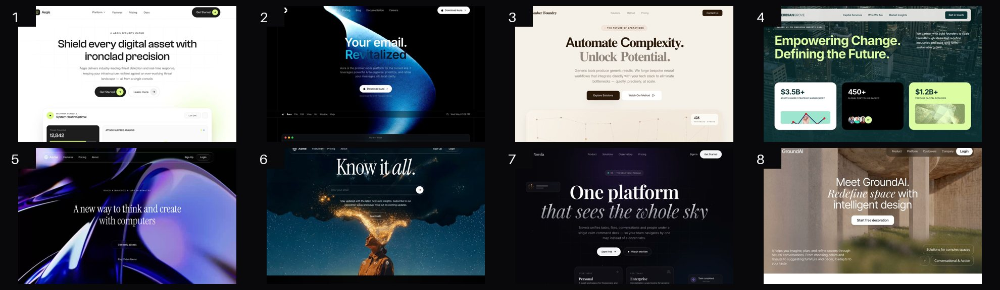

# Prompt Motion Site Web Builder: a free Claude skill

**Make Claude build cinematic, animated websites instead of average AI layouts.**

AI-built websites tend to look the same for three reasons: a vague plan, no real media, and nobody looking at the result. This skill fixes all three. Claude studies full templates from [Prompt Motion Site](https://promptmotionsite.com/?utm_source=github&utm_medium=claude-skill&utm_campaign=web-builder), picks real cinematic media, writes a precise build spec, builds the page, then **screenshots its own work and fixes it** until it clears a gallery-level bar.


<sub>8 of the 40 full templates inside the skill.</sub>

## What's inside
- **40 full multi-section templates** across six sectors: SaaS, agency, productivity, real estate, fashion and health. Claude reads the closest 2–3 for every brief to match their level of detail.
- **A media shelf:** preview videos of every template, publicly hosted and shown on numbered contact sheets so Claude picks media by eye.
- **55+ technique recipes** with working code: seamless video loops, liquid glass, word-by-word blur headlines, mouse-scrubbed video, depth carousels, scroll stories, real 3D models (Three.js) and more.
- **Design taste rules with real numbers:** type scale, tracking, spacing, colour, motion timing and copy.
- **A spec template:** the precise brief Claude writes before coding.
- **A look-and-fix loop:** a screenshot and QA script (broken assets, mobile overflow, fonts, video playback) and a scoring rubric.
- **Prompt mode:** ask for a prompt instead of code, and get one tuned for Lovable, Bolt, v0, Cursor, Manus, Google AI Studio or Kimi.

## Install

### Claude.ai and Claude desktop
1. Download **`promptmotionsite-web-builder.zip`** from the [latest release](../../releases/latest).
2. In Claude, open **Customize → Skills → + → Create skill → Upload a skill**, choose the zip and switch the skill on. (Code execution must be enabled in Settings → Capabilities.)

### Claude Code (plugin)
```
/plugin marketplace add promptmotionsite/claude-skill
/plugin install promptmotionsite-web-builder@promptmotionsite
```
No GitHub SSH key? Use `/plugin marketplace add https://github.com/promptmotionsite/claude-skill.git` instead.

### Claude Code (manual)
Copy `plugins/promptmotionsite-web-builder/skills/promptmotionsite-web-builder` into `~/.claude/skills/`.

### Optional: let Claude see its work
```
pip install playwright && python -m playwright install chromium
```

## Try it
Just ask Claude for a site. The skill kicks in automatically:
- *"Build a landing page for a boutique real-estate agency in Lisbon. Quiet and editorial."*
- *"Make a full SaaS website for a cybersecurity console, dark and precise."*
- *"Write a Lovable prompt for a waitlist page for my AI travel app."*
- *"Here's my current site: make it look award-winning."*

## Want the full library?
The examples in this skill are a **free sample**. The **[Web Creator Pass](https://promptmotionsite.com/?utm_source=github&utm_medium=claude-skill&utm_campaign=web-builder&utm_content=readme)** unlocks:
- **Nearly 1,000 prompts:** animated and 3D websites, hero sections and full templates for every sector
- **One-click formatting** for Lovable, Claude, Cursor, Bolt and v0
- **The Studio,** to adapt any reference to your own brand
- **One payment, lifetime access,** for personal and client work

**[Explore Prompt Motion Site](https://promptmotionsite.com/?utm_source=github&utm_medium=claude-skill&utm_campaign=web-builder&utm_content=readme)**

## Credits and license
MIT, see [LICENSE](LICENSE). Copyright © 2026 Prompt Motion Site.
